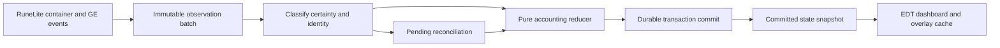

# Architecture and implementation plan

## Scope and inspection

M1/M2 passed user-run acceptance; M2 is committed as `9e6b757`. M3 adds immutable virtual ownership, format-2 migration, a bank-only widget-item overlay, draw-only fading and active-sidebar cleanup. M3 is functionally accepted; the subsequent lock-appearance refinement awaits visual acceptance. Acquisitions, transfers, buybacks, GE accounting, mobile reconciliation and valuation remain unimplemented. No code was taken from purpleCounter.

The M2 checkout was clean on `master` at the user-created foundation commit. AGENTS.md and CLAUDE.md were reread. Java 11, the existing Gradle 8.10 Wrapper and dependency layout remain. `latest.release` resolves to RuneLite 1.13.3; actual identity/container/Filepath sources were checked. See [compatibility evidence](docs/COMPATIBILITY.md).

## Packages and responsibilities

| Package | Classes | Scope |
| --- | --- | --- |
| `com.fromscratch` | `FromScratchPlugin`, `FromScratchConfig` | Implemented lifecycle, DI, preferences |
| `model` | `RunState`, `RunStatus`, `RunRecord`, `InitializationSession`, `LegacySnapshot`, `ContainerSnapshot`, `SnapshotLocation`, `VirtualEconomy`, `VirtualOwnership`, `VirtualItemOwnership`, `VirtualLocation` | Immutable baseline, lifecycle/setup, exact-ID virtual totals and allocations; currency/wealth placeholders |
| `ui` | `FromScratchSidebar`, `FromScratchPanel`, `SetupView`, `SetupActions` | Implemented EDT presentation and confirmed local requests |
| `controller` | `SetupController` | Implemented client/worker coordination and stale-callback rejection |
| `observation` | `RuneLiteSnapshotObserver`, `BankSnapshotReader`, `PersonalContainerReader`, `EmptyContainerVerifier`, `WidgetReadNode`, `SnapshotSource`, `SnapshotAssembler`, `ObservedItem`, `CharacterIdentity` | Implemented identity verification, complete initial container capture and independent empty personal-container verification |
| `overlay` | `VirtualBankOverlay`, `BankItemPainter`, `BankOverlayState`, `BankOverlayRegistration`, `VirtualQuantityFormatter` | Normal-bank rendering, immutable projections, cached labels, independent settings and exactly-once registration |
| `accounting` | `AccountingEngine`, `Transaction`, `LedgerEntry`, `OwnershipAllocation` | Planned pure reducer, invariants, audit history |
| `persistence` | `RunRepository`, `RunRecordCodec`, `SaveIntegrity`, `SaveException` | Implemented versioned checksummed checkpoints, archival reset, read-only failure handling; future journal/migrations |
| `valuation` | `PriceSnapshot`, `WealthCalculator`, `CostBasis` | Planned cached prices and historical basis |
| `buyback` | `BuybackCatalog`, `BuybackService` | Planned eligibility and atomic spend/unlock |

Subpackages are beneath `com.fromscratch`. Future names are guidance, not empty scaffolding. Introduce classes with meaningful milestone tests. Resolve gameval constants from the actual API instead of embedding item/widget IDs.

## Lifecycle and thread ownership

RuneLite injects config, observer, coordinator, repository and sidebar. Swing handles navigation and dialogs. All identity/container access and InitializationSession mutation occur on the client thread. A bounded single background worker performs all storage, including obtaining the plugin directory. Its results return via ClientThread.invokeLater and are rejected after a character/context/lifecycle change. The UI receives immutable SetupView objects, never live client state.

Shutdown invalidates callbacks, calls shutdownNow without waiting, removes navigation and unregisters the single bank overlay. No scheduled task, timer, custom network or gameplay action is created. An already completed but unacknowledged write is discovered by reload; an incomplete write preserves recovery evidence. Never report Active before successful durable storage. Repeated toggles and stale callback orderings have deterministic tests.

The root 48x48 Hub icon and bundled 24x24 resource are separate small assets. RuneLite `ImageUtil.loadImageResource` loads the class-relative resource. Classpath resources are distinct from user-data file storage.

The panel offers Begin, complete preview, explicit confirmation, protected Reset and Retry Load. Initialization retains capture summaries needed for confirmation. Active runs hide legacy item/GP totals, setup/debug instructions and temporary milestone cards; the run start time and main dashboard remain. Currency/wealth metrics and the play timer remain placeholders. An incomplete preview is never saved as empty startup state.

## M3 ownership and rendering

VirtualOwnership is an immutable hash map by exact item ID, independent of the legacy baseline and physical quantities. Missing records and locations are valid zeros. VirtualItemOwnership stores a separate nonnegative long total and sparse BANK/INVENTORY/EQUIPMENT/GRAND_EXCHANGE allocations. Checked allocation sum must not exceed total; the difference is unallocated ownership, never automatically credited to bank. Zero records normalize away. Notes/variants remain distinct raw IDs. Pure replacement returns a new ownership object; RunRecord.withOwnership creates a new revision while preserving the run header and original LegacySnapshot. Only future validated accounting commands may call these operations; M3 has no observation-driven edits or grant UI.

SetupController sends committed Active views to BankOverlayState before Swing. Its immutable projection contains ownership and preformatted positive bank labels; missing entries return constant "0". Settings are a separate immutable snapshot, refreshed on ConfigChanged. Loading, error, reset/save-in-progress, logout and disable clear the projection. Render-time identity checking also prevents showing another character's run between ticks. Same-character RuneLite configuration-profile changes retain the valid projection.

VirtualBankOverlay is a manual/dynamic/low-priority Overlay hooked only after InterfaceID.Bankmain.ITEMS. Its frame gate checks enabled/Active, verified character, mounted visible normal bank and PIN absence. The earlier WidgetItemOverlay path consumed RuneLite 1.13.3's item list, which tests whether the item origin is inside the clip. Consequently it omitted the still-visible bottom portion of a top-clipped row. Installed renderer bytecode inspection confirmed that coordinates are updated before that origin test. No unsupported members or obfuscated names are used in production.

The replacement reads the current ITEMS layer's actual child widgets, requiring the expected component, direct parent, GRAPHIC type, visible state and real item ID. It uses Widget.getBounds and Rectangle.intersects against the content viewport (ITEMS bounds intersected with ITEMS_CONTAINER bounds), then intersects the original graphics clip and full item bounds for painting. Partial top, bottom and side intersections are included; mere edge contact and offscreen items are excluded. Tabs/search controls, bank-side inventory, shared/special storage and equipment are outside this source/clip. No fixed slot/grid coordinates are computed. A zero-quantity or definition-identified placeholder always displays zero; bank fillers, BLANKOBJECT sentinels and negative IDs are skipped.

RuneLite's current OverlayManager widget list is consulted only for an actual drag rectangle; it is no longer the source of ordinary bank-item visibility. The same widget is painted once at its supplied drag position. If an active dragged widget is missing that rectangle because its origin is clipped, its transient effect is omitted rather than painted at the old slot or inferred from mouse coordinates. It returns on release. Context provides a synchronous client-thread visitor for testing; no per-item DTO or ownership map is constructed. Purple labels always use full item bounds, never the intersected fragment.

BankItemPainter uses the bundled RuneLite small font, black shadow and bottom-right alignment. The lock is a uniform dark neutral-gray tint (RGB 80/80/80, alpha 122/255, approximately 48%) over the complete current item bounds. This replaces the first refinement's RGB 128/alpha 77 tint, which the user requested be slightly darker. The darker neutral color is closer to the bank background, reducing tile contrast while muting colorful sprites. There is no reserved top band or partial-height rectangle. This fallback is not full sprite grayscale; it also tints the background and ordinary quantity glyphs, retaining approximately 52% contrast. Purple counters are drawn last without tinting. The original 57%-opaque black mask started 12 pixels down, causing the earlier bright-top/dark-bottom split. Graphics paint/font/clip are restored; game widgets, sprites, IDs, quantities, menus and click zones are never changed. Java2D/client transforms apply scaling; no second UI scaling factor is invented. Other overlays may compete for the same corner, requiring manual compatibility tests.

RuneLite 1.13.3 provides ItemManager.getImage, Client.createItemSprite and ImageUtil.grayscaleImage. These create/convert a separate image rather than desaturating the already-composited bank item. Redrawing it safely would require matching the actual sprite, its quantity glyphs, border, shadow, opacity and drag appearance. ItemManager uses its own fixed border/shadow/quantity-mode options, and Widget does not expose a sprite-shadow getter. Cached generated grayscale replacement was therefore not adopted for this correction. One full-bounds fill per locked visible item avoids additional sprite-generation, grayscale-conversion or image-cache work; see docs/COMPATIBILITY.md.

No disk/price/accounting work occurs in rendering. The source makes a linear pass over the current bank item widgets; only intersecting items are drawn or trigger cached placeholder lookups. Ownership/label lookup is O(1), labels/maps are built only when the committed projection changes, and placeholder definitions are cached by item ID for the enabled lifecycle. There is no new image cache, sprite generation, grayscale conversion or per-frame item map. Registration is idempotent; shutdown clears render data and the definition cache. Actual client scrolling cost and layout compatibility still require manual acceptance/profiling; a clean build is not that evidence.

## Run lifecycle and identity

Stable states: NOT_STARTED, INITIALIZING, ACTIVE, NEEDS_RECONCILIATION, COMPLETED. No pause. RunState validates schema, opaque character key, UUID, status, and start/end instants. Initialization has an ID but no activation time. Ongoing runs require activation time and no end time. Completed runs require an ordered end time. Invalid headers fail without producing an empty replacement.

M2 supports NOT_STARTED -> ephemeral INITIALIZING -> persisted ACTIVE, and confirmed reset -> persisted NOT_STARTED. Reset archives the active run and does not create a replacement. Initialization requires a complete snapshot and confirmation. Reload preserves UUID, times and baseline; cancellation/logout/disable discard only an unconfirmed preview. NEEDS_RECONCILIATION/COMPLETED are stable header names reserved for future engines; M2 refuses unsupported persisted states rather than erasing them.

M2 verifies LOGGED_IN/local player, live account hash, current RuneScapeProfileType and the selected ConfigManager RS profile against one matching RuneScapeProfile. The stable storage key is SHA-256 of a namespaced versioned account-hash/type tuple. Unlike a random configuration key, it remains stable across display-name and RuneLite config-profile changes; standard/temporary world profile types remain separated. Raw account hashes, display names, inventories and paths are never logged. Unknown/mismatched/ambiguous identity blocks setup and storage. Tests exercise renames, changed config keys, characters and profile types.

## M2 snapshot availability

Bank readiness is independent of ItemContainerChanged. RuneLite's BankPlugin uses WidgetLoaded/WidgetClosed for BANKMAIN lifecycle and quantity events for cache invalidation. The former fresh-event gate was incorrect: reopening an unchanged bank need not produce another quantity event, and an early failed capture previously stopped retrying.

RuneLiteSnapshotObserver checks the live mounted-interface component table, so cached widget definitions/closed-bank containers cannot establish readiness. BankSnapshotReader requires BANKMAIN mounted, Bankmain.ITEMS_CONTAINER visible, no BANKPIN_KEYPAD/BANKPIN_SETTINGS mounted, and a settling game tick for current bank capture. It always reads the complete BANK container while the normal bank is open, including confirmation. An already-open bank is discoverable without WidgetLoaded. Null/partial bank data is unavailable; a validated non-null empty bank is legitimate. Visible bank item children and search/tab counts are never bank snapshot sources.

The 1.13.3 Client getter is explicitly nullable for each container; core ItemStatPlugin/ItemStatOverlay null-check INV/WORN independently. Simultaneous availability is not an API promise. During INITIALIZING, poll all available personal containers even before the bank opens. Keep immutable validated observations for at most 60 seconds in this uninterrupted verified-character setup session. Null reads never create empty data or refresh observation age. A partial/invalid observation invalidates that location. Container events invalidate the changed location, optionally copy its valid event payload, and require a settling tick. A changed previously observed bank also invalidates both cached personal observations to avoid mixing transfer sides. Initial bank loading does not itself prove a personal change.

WidgetLoaded/Closed invalidate bank readiness; GameTick polls only pending setup, including ready previews, so observations expire even without events. Complete current bank data combines with valid personal observations into an immutable preview. Confirmation revalidates identity, current bank and available personal data, age and change guards. Changed contents expire the review token; missing/stale data disables confirmation and identifies the normal interface to open manually. Cancel, logout, identity change, disable and a new Begin discard ephemeral observations. Active baselines never recapture. CaptureProgress exposes each location independently; equal SetupView objects do not rebuild Swing each tick.

Observed zero-length/all-empty-slot containers are valid; no positive-count requirement exists. The user isolated the live failure to empty INV/WORN: the adapter lacked a way to verify that absent API objects represented empty locations. PersonalContainerReader still prefers complete API arrays. For null INV/WORN only, EmptyContainerVerifier requires every slot in a mounted, visible personal interface to show its initialized empty state on two different game ticks. Inventory uses all 28 hidden BLANKOBJECT children (normal or bank-side inventory). Equipment uses all 11 logical item slots, each with its hidden item child and visible initialized empty icon. Ring/ammo are included; player appearance is not evidence. Missing/default/partial widgets stay unknown. A visible item with a null container rejects cached observations instead of reconstructing populated contents from widgets.

Verification candidates reset on item-container events, personal interface load/close, identity/session changes and Begin/cancel. Completed empty observations follow the existing 60-second cache/invalidation policy. Complete BANK data and explicit confirmation remain mandatory; no bank widget fallback exists. Checked long aggregation, placeholder/filler exclusion and raw variants are unchanged. DEBUG diagnostics remain limited to one line per ten seconds and add emptyVerification status without item lists or identity. No independent packet-completeness/version signal exists; unsupported layouts remain blocked. Save schema and persistence are unchanged.

## Planned flow

Copy container counts on the client thread and coalesce related events. A deposit may emit separate container updates; an intermediate increase alone must not become an acquisition. Preserve raw item IDs plus explicit supported canonical mappings. Placeholders own zero quantity; missing containers are unknown.

The reducer takes a character/run identity, prior state, and typed command. It returns a validated transaction/candidate state or a reconciliation requirement. It has no widgets, files, network, or Swing dependencies. Deduplicate event references within the run. UI/overlay data comes from committed immutable snapshots; renderers do not scan scenes or calculate wealth.

## M2 persistence and future ledger

Permanent storage decision: one designated host computer owns the local progression files. Cloud synchronization, cloud credentials, cloud storage and third-party backends are out of scope permanently. Mobile/other-computer activity is reconciled against observations when returning to that host (M4), not merged from remote saves. Manual backups and deliberate host migration remain supported procedures; no external service is added.

M2 wrote envelope format 1 with header schema 1. M3 writes envelope format 2, adding required ownership totals/all four location fields; the unchanged lifecycle header stays schema 1. The injected Gson explicit-tree codec validates integer syntax/ranges, strict fields, constructors, identity and payload checksum. Currency/wealth and the legacy reserved virtualEconomy.items field remain zero/empty until a later explicit migration; ownership is now the sole persisted virtual item source. Missing format-2 ownership is corruption; absent item records inside a valid ownership object are zero. Future formats/fields are rejected intact.

On worker-thread load under the character lock, a verified format-1 document is copied byte-for-byte to migration-v1-<unique>.json, forced, decoded and compared before migration. A new storage revision with zero virtual ownership is checkpointed/published through the existing recovery path; run ID, character/header, times, reset history and exact LegacySnapshot are preserved. Older checkpoints/archives are not rewritten. A failed backup/migration blocks loading and preserves recovery evidence. A missing current file with migration evidence also blocks blank startup. Format-2 restarts do not migrate again. Older M2 software cannot open format 2; deliberate downgrade requires a compatible retained backup with clients closed.

The plugin Filepath directory contains characters/<opaque-key>/current.json, checkpoint-<revision>.json, archive-<run>-<unique>.json and a cooperative run.lock. There is no repository-relative progression path. Reads and writes use a nonblocking per-character file lock to reject conflicting clients. Save size is bounded. Load does not write a default run.

Commit: force and validate a new immutable checkpoint; force a pending current file; atomically replace current.json where supported; otherwise copy/force with the checkpoint retained; validate current before acknowledgment. Reset first copies, forces and validates a unique archive. Its Not Started record prevents reloading an old active checkpoint automatically. Missing/corrupt/incompatible current data is an explicit error; files are preserved and setup is blocked. Recovery is manual, documented in README; no automatic checkpoint promotion or import/export UI exists yet. Retained checkpoints/archives are not automatically pruned. File forcing plus recoverable copies does not guarantee survival of every filesystem/hardware failure.

RunRepository tests inject publication failures after checkpoints/archives to verify preservation and blocked blank restarts. A test-only Filepath.Unchecked root is confined to JUnit-created synthetic temporary directories; production uses only Plugin.getPluginDirectory and supported Filepath operations.

The growing transaction journal remains future work:

A transaction includes UUID, sequence, timestamp, character/run IDs, classification, source/reference, confidence/reconciliation status, item/location/legacy/virtual deltas, cash deltas, and reference valuation/basis changes. Multiple entries represent one transfer, bundle, or buyback. Corrections append linked adjustments, never rewrite history. Observation IDs and GE lifecycle references prevent duplicate credits.

The future ledger envelope will add sequence/replay metadata with explicit migration from the M2 checkpoint format. Migrate then validate; direct deserialization must not bypass constructors. Unsupported versions are preserved. The header version and outer storage format version are distinct compatibility boundaries.

All storage uses `Plugin.getPluginDirectory()` / `Filepath` under internal name `from_scratch`, with per-character/run namespaces. Small preferences remain in ConfigManager; the journal is not one config string. No raw file escape, Filepath.Unchecked, Java serialization, or plugin-created external process.

Serialize writes on a bounded background executor; never block the client thread. Acknowledge financial actions only after durable whole-transaction commit. A complete journal record is the commit boundary. Write/force temporary files through Filepath, use atomic replacement when supported, retain known-good checkpoints, and recover complete records after their checkpoint sequence. Incomplete trailing records cannot partially unlock a bundle. Crash tests cover append/force/checkpoint/rename and non-atomic filesystem fallback. Replay must be idempotent and identity-checked.

Cancel any future scheduled tasks and call shutdownNow without waiting. Future import/export must validate schema/identity/quantities/sequences/integrity in staging and use Filepath.Chooser. M2 already supplies conservative checkpoint recovery/error handling and confirmed archival reset, but no general transaction journal or import/export.

## Compliance and capability limits

- Enforcement uses visual overlays/warnings. No input injection, action blocking, packets, server-directed menu additions, or conditional removals are planned.
- Container events expose counts, not provenance. Identical copies cannot be identified individually. Special storage is excluded; death fees require reliable evidence or manual entry.
- Offline history, missing bank data, and ambiguous transformations cannot be reconstructed. Preserve trusted state and reconcile.
- GE events do not guarantee complete trading history. Commitments, partial fills, tax, uncollected positions, and collection require targeted evidence.
- The core Examine plugin uses normal menu observation and local queued chat. M8 must validate context/deduplication while preserving original messages and outgoing chat.
- Prices are estimates. Unpriced untradeables have zero market valuation and an explicit incomplete marker.
- No external server, telemetry, custom HTTP, reflection, native access, or new production dependency is needed.

References: [Jagex guidelines](https://secure.runescape.com/m=news/third-party-client-guidelines?oldschool=1), [rejected features](https://github.com/runelite/runelite/wiki/Rejected-or-Rolled-Back-Features), [Hub review](https://github.com/runelite/runelite/wiki/Plugin-Hub-Review).

## Decisions before dependent milestones

| Decision | Proposed direction | Resolve before |
| --- | --- | --- |
| Identical-copy allocation | Virtual allocation only for reliable ordinary transfers; reconcile uncertainty | M4 |
| Notes/charges/doses/recolors | Explicit mappings; no blanket variation-group merging | M3/M4 |
| Physical legacy GP spending | Warn/reconcile; never recompute virtual cash from the remaining physical stack | M5 |
| Cost basis | Pooled weighted average with exact remainder handling per ACCOUNTING.md | M5 |
| Non-Graceful outfit bundles | Full sets; exact recolor/upgrade/partial rules still required | M7 |
| Graceful variants | Six standard locked pieces required; natural quantities remain independent | M7 |
| Time played vs elapsed duration | Separate elapsed run time and observable logged-in time; disclose mobile gaps | M8 |
| Unobserved locations | Explicit unknown/reconciliation; invisibility alone is not loss | M4 |

These remain documented choices for later engines, not silently implemented rules. None blocks M2's immutable exact-ID baseline.

## Milestone plan and gates

| Milestone | Work | Automated gate | User acceptance |
| --- | --- | --- | --- |
| 1 Foundation | Identity, lifecycle, sidebar, header, artwork, docs, CI | Header/UI/resource/Java 11 tests and clean build | Launch, sidebar, toggles, help, login states |
| 2 Initial Snapshot | Complete containers, legacy capture, per-character saves, protected reset | Empty/populated/placeholders/gear/GP, duplicate init, identity, reload | Correct full snapshot, zero virtual balances |
| 3 Virtual Bank | Location quantities, purple counts, gray legacy items | Quantity/display models, restart | Scroll/tabs/search/scaling/withdrawn stacks |
| 4 Transfers/Acquisitions | Coalesced events, allocation, corrections, offline changes | Conservation, deduplication, ambiguity/mobile cases | Transfer and reconciliation scenarios |
| 5 Currency/Wealth | Ledger, cash/debt/commitments, basis, pricing, losses | Arithmetic bounds, debt, valuation, conversions | Costs and totals agree with ledger |
| 6 GE | Partial offers, positions, tax, cancellation, collection | Offer replay and collection deduplication | Partial fills/cancels/collection choices |
| 7 Buybacks | Curated catalog, bundles, atomic transactions | Catalog/exclusion/copy/crash tests | Eligible unlocks, physical cash unchanged |
| 8 UI Completion | Examine, history, bank view, settings, charts/time | Values/formatting/deduplication | Readability, context-specific examines |
| 9 Hardening | Recovery, migrations, profiling, compliance | Full regression and recovery | User-run regression/performance |
| 10 Publication | Release candidate, final metadata/art, manifest/PR materials | Reverify current rules and clean build | Explicit approval before submission |

Stop after each authorized milestone and report evidence. No automatic commit, push, publication, or later-milestone implementation.
