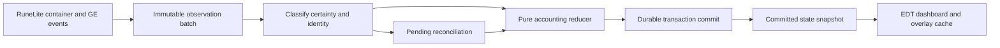

# Architecture and implementation plan

## Scope and inspection

M1 implements lifecycle/config wiring, a preview sidebar, icon assets, and an immutable versioned lifecycle header. Planned services below are not implemented. No active run, accounting, observation pipeline, or progression storage is enabled.

Initial Git status was clean on `master`. AGENTS.md was read; CLAUDE.md delegates to it. Java 11 and the existing Gradle 8.10 Wrapper remain. `latest.release` resolved to RuneLite 1.13.3. Actual dependency sources were checked; see [compatibility evidence](docs/COMPATIBILITY.md).

## Packages and responsibilities

| Package | Classes | Scope |
| --- | --- | --- |
| `com.fromscratch` | `FromScratchPlugin`, `FromScratchConfig` | Implemented lifecycle, DI, preferences |
| `model` | `RunState`, `RunStatus` | Implemented validated schema-v1 lifecycle header |
| `ui` | `FromScratchSidebar`, `FromScratchPanel` | Implemented EDT-confined navigation and preview |
| `observation` | `ContainerObserver`, `ObservationBatch`, `GeObserver` | Planned immutable API observations |
| `accounting` | `AccountingEngine`, `Transaction`, `LedgerEntry`, `OwnershipAllocation` | Planned pure reducer, invariants, audit history |
| `persistence` | `RunRepository`, `SaveEnvelope`, `SaveMigrator` | Planned Filepath storage and recovery |
| `valuation` | `PriceSnapshot`, `WealthCalculator`, `CostBasis` | Planned cached prices and historical basis |
| `buyback` | `BuybackCatalog`, `BuybackService` | Planned eligibility and atomic spend/unlock |

Subpackages are beneath `com.fromscratch`. Future names are guidance, not empty scaffolding. Introduce classes with meaningful milestone tests. Resolve gameval constants from the actual API instead of embedding item/widget IDs.

## Foundation lifecycle

RuneLite injects the config and sidebar. Lifecycle work is queued onto Swing's EDT without waiting. The controller registers at most one button and removes that exact registration on shutdown. Repeated toggles are safe. Config events refresh presentation only. M1 creates no executors, timers, overlays, game handlers, network clients, or progression files.

The root 48x48 Hub icon and bundled 24x24 resource are separate small assets. RuneLite `ImageUtil.loadImageResource` loads the class-relative resource. Classpath resources are distinct from user-data file storage.

The panel always discloses its placeholder values. No start action is supplied before snapshot and persistence exist. An unbound preview is never saved as a character's empty run.

## Run lifecycle and identity

Stable states: NOT_STARTED, INITIALIZING, ACTIVE, NEEDS_RECONCILIATION, COMPLETED. No pause. RunState validates schema, opaque character key, UUID, status, and start/end instants. Initialization has an ID but no activation time. Ongoing runs require activation time and no end time. Completed runs require an ordered end time. Invalid headers fail without producing an empty replacement.

Planned transitions: NOT_STARTED -> INITIALIZING -> ACTIVE; ACTIVE <-> NEEDS_RECONCILIATION; explicit confirmed end -> COMPLETED. Initialization requires a complete snapshot and user confirmation. Reset archives the prior run before creating a new one. Reload preserves the run UUID; cancellation does not destroy prior durable state.

Use RuneLite's RS character profile key once available, respecting account/profile type boundaries. Display names and RuneLite configuration profiles alone are not character identities. Test account switches, renames, profile switches, and repeated login events. Use an opaque safe encoding/hash for filenames. Unknown identity means loading/read-only, never a shared default save. No private identity is logged.

## Planned flow

Copy container counts on the client thread and coalesce related events. A deposit may emit separate container updates; an intermediate increase alone must not become an acquisition. Preserve raw item IDs plus explicit supported canonical mappings. Placeholders own zero quantity; missing containers are unknown.

The reducer takes a character/run identity, prior state, and typed command. It returns a validated transaction/candidate state or a reconciliation requirement. It has no widgets, files, network, or Swing dependencies. Deduplicate event references within the run. UI/overlay data comes from committed immutable snapshots; renderers do not scan scenes or calculate wealth.

## Planned ledger and persistence

A transaction includes UUID, sequence, timestamp, character/run IDs, classification, source/reference, confidence/reconciliation status, item/location/legacy/virtual deltas, cash deltas, and reference valuation/basis changes. Multiple entries represent one transfer, bundle, or buyback. Corrections append linked adjustments, never rewrite history. Observation IDs and GE lifecycle references prevent duplicate credits.

Use injected Gson with versioned JSON DTOs. Migrate then validate into domain constructors; direct deserialization must not bypass validation. The envelope includes identity, schema, sequence, checkpoint, and integrity metadata. Reject unsupported versions without changing originals. M1's v1 header is not a promised full accounting file format; later schema expansion needs migration tests.

All storage uses `Plugin.getPluginDirectory()` / `Filepath` under internal name `from_scratch`, with per-character/run namespaces. Small preferences remain in ConfigManager; the journal is not one config string. No raw file escape, Filepath.Unchecked, Java serialization, or plugin-created external process.

Serialize writes on a bounded background executor; never block the client thread. Acknowledge financial actions only after durable whole-transaction commit. A complete journal record is the commit boundary. Write/force temporary files through Filepath, use atomic replacement when supported, retain known-good checkpoints, and recover complete records after their checkpoint sequence. Incomplete trailing records cannot partially unlock a bundle. Crash tests cover append/force/checkpoint/rename and non-atomic filesystem fallback. Replay must be idempotent and identity-checked.

Cancel scheduled tasks and call shutdownNow without waiting. Recover interrupted work at restart. Errors produce read-only recovery UI, never overwrite good data with empty state. Reset requires backup success and confirmation. Import validates schema/identity/quantities/sequences/integrity in staging before replacement. Import/export uses Filepath.Chooser. None of this storage is enabled in M1.

## Compliance and capability limits

- Enforcement uses visual overlays/warnings. No input injection, action blocking, packets, server-directed menu additions, or conditional removals are planned.
- Container events expose counts, not provenance. Identical copies cannot be identified individually. Special storage is excluded; death fees require reliable evidence or manual entry.
- Offline history, missing bank data, and ambiguous transformations cannot be reconstructed. Preserve trusted state and reconcile.
- GE events do not guarantee complete trading history. Commitments, partial fills, tax, uncollected positions, and collection require targeted evidence.
- The core Examine plugin uses normal menu observation and local queued chat. M8 must validate context/deduplication while preserving original messages and outgoing chat.
- Prices are estimates. Unpriced untradeables have zero market valuation and an explicit incomplete marker.
- No external server, telemetry, custom HTTP, reflection, native access, or new production dependency is needed.

References: [Jagex guidelines](https://secure.runescape.com/m=news/third-party-client-guidelines?oldschool=1), [rejected features](https://github.com/runelite/runelite/wiki/Rejected-or-Rolled-Back-Features), [Hub review](https://github.com/runelite/runelite/wiki/Plugin-Hub-Review).

## Decisions before dependent milestones

| Decision | Proposed direction | Resolve before |
| --- | --- | --- |
| Identical-copy allocation | Virtual allocation only for reliable ordinary transfers; reconcile uncertainty | M4 |
| Notes/charges/doses/recolors | Explicit mappings; no blanket variation-group merging | M3/M4 |
| Physical legacy GP spending | Warn/reconcile; never recompute virtual cash from the remaining physical stack | M5 |
| Cost basis | Pooled weighted average with exact remainder handling per ACCOUNTING.md | M5 |
| Non-Graceful outfit bundles | Full sets; exact recolor/upgrade/partial rules still required | M7 |
| Graceful variants | Six standard locked pieces required; natural quantities remain independent | M7 |
| Time played vs elapsed duration | Separate elapsed run time and observable logged-in time; disclose mobile gaps | M8 |
| Unobserved locations | Explicit unknown/reconciliation; invisibility alone is not loss | M4 |

These are documented future choices, not silently implemented rules. None blocks M1.

## Milestone plan and gates

| Milestone | Work | Automated gate | User acceptance |
| --- | --- | --- | --- |
| 1 Foundation | Identity, lifecycle, sidebar, header, artwork, docs, CI | Header/UI/resource/Java 11 tests and clean build | Launch, sidebar, toggles, help, login states |
| 2 Initial Snapshot | Complete containers, legacy capture, per-character saves, protected reset | Empty/populated/placeholders/gear/GP, duplicate init, identity, reload | Correct full snapshot, zero virtual balances |
| 3 Virtual Bank | Location quantities, purple counts, gray legacy items | Quantity/display models, restart | Scroll/tabs/search/scaling/withdrawn stacks |
| 4 Transfers/Acquisitions | Coalesced events, allocation, corrections, offline changes | Conservation, deduplication, ambiguity/mobile cases | Transfer and reconciliation scenarios |
| 5 Currency/Wealth | Ledger, cash/debt/commitments, basis, pricing, losses | Arithmetic bounds, debt, valuation, conversions | Costs and totals agree with ledger |
| 6 GE | Partial offers, positions, tax, cancellation, collection | Offer replay and collection deduplication | Partial fills/cancels/collection choices |
| 7 Buybacks | Curated catalog, bundles, atomic transactions | Catalog/exclusion/copy/crash tests | Eligible unlocks, physical cash unchanged |
| 8 UI Completion | Examine, history, bank view, settings, charts/time | Values/formatting/deduplication | Readability, context-specific examines |
| 9 Hardening | Recovery, migrations, profiling, compliance | Full regression and recovery | User-run regression/performance |
| 10 Publication | Release candidate, final metadata/art, manifest/PR materials | Reverify current rules and clean build | Explicit approval before submission |

Stop after each authorized milestone and report evidence. No automatic commit, push, publication, or later-milestone implementation.
