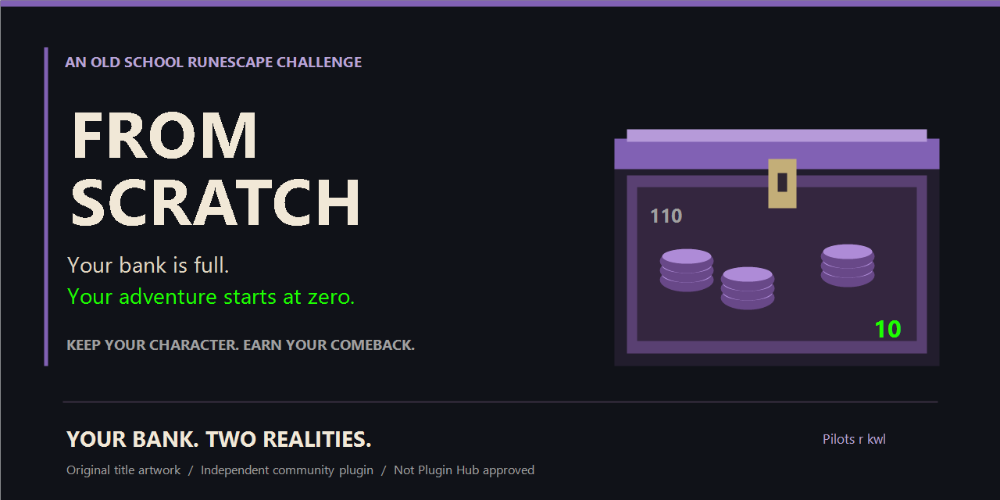

# FROM SCRATCH

**Your bank is full. Your adventure starts at zero.**

Rediscover the thrill of starting with nothing—without abandoning the character you've spent years building.

From Scratch turns your existing Old School RuneScape character into a fresh challenge. Keep your levels, quests and account unlocks. Set your old bank aside as **legacy**, build your virtual bank through normal gameplay, and earn your way back into the equipment you once took for granted.

**One character. A completely new reason to play.**

<a href="docs/INSTALLATION.md"><strong>Play From Scratch</strong></a> · <a href="docs/FEATURES.md">Explore the features</a> · <a href="docs/BETA_TESTING.md">Beta tester guide</a>

## Play From Scratch

**Windows friend-and-family beta: prepared locally, not published yet.** The reviewed ZIP will appear on [GitHub Releases](https://github.com/PilotsRKwl/fromScratch/releases) after owner approval. There is no public beta download or official Plugin Hub listing yet.

The beta flow is simple: install the official Java 11 prerequisite once, extract the ZIP, run **Install.cmd**, then open the **From Scratch Beta** desktop shortcut. No IntelliJ, Git or Gradle is needed to play. Sign in through RuneLite's own Jagex Accounts panel; From Scratch never asks for your password or tokens.

[Installation and supported login](docs/INSTALLATION.md) · [Known limitations](docs/FEATURES.md#boundaries) · [Report a bug](https://github.com/PilotsRKwl/fromScratch/issues)

## Your next adventure starts at zero

1. **Keep the account you've built.** Your levels, quests and real possessions stay yours.
2. **Bank your inventory and gear.** Confirm the setup instructions, then start the challenge. Your complete bank becomes the permanent legacy baseline.
3. **Make the next drop matter.** Bank your new items and watch the virtual quantities grow.
4. **Earn it back.** Acquire new equipment normally, or spend challenge GP to unlock approved legacy untradeables.
5. **Watch your comeback.** Track current bank wealth, peak progress, unlocks and time played.

Your real items are never deleted or moved by the plugin. This is a voluntary challenge, with normal OSRS banking and gameplay throughout.

## See your comeback

Gray physical counts show what's really in the bank. Bright virtual counts show your challenge's signed bank balance. Darkened legacy items make the distinction immediate.

**Real gameplay screenshots are awaiting the owner's capture pass.** The image above is original title artwork, not a gameplay screenshot. The [capture plan](docs/SCREENSHOTS.md) covers the live dashboard, mixed stacks, native tabs, buybacks and finalized GE history. Only authentic, privacy-safe captures will enter this gallery.

## Your Bank. Two Realities.

Your physical bank stays intact. **Virtual Bank** filters the real interactive bank to item types with positive virtual balances, including within native tabs. Prefer to see everything? Turn off the single **Enable Virtual Bank View** checkbox in RuneLite Settings.

A mixed stack can still contain 110 physical sharks while only 10 are available for the challenge. The gray count stays 110; the bright count stays 10. Native withdrawal controls remain unchanged—From Scratch does not enforce the rules for you.

## Every Drop Matters Again.

A handful of logs. Your first profitable trip. That next equipment upgrade. Banking new items moves your challenge forward automatically. Withdrawals move the signed balance down; outstanding legacy balances remain visible and persist across restarts.

No inventory checklist after every trip. No ordinary reconciliation wizard. Bank your items and play.

## Earn It Back.

The **Legacy Buybacks** catalog turns challenge GP into permanent access to approved legacy equipment. Browse compact cards for Combat Gear, Skilling Outfits, and Utility & Storage.

Buy back a Fire Cape for **1000K GP**. Unlock the **Rune Pouch / Divine Rune Pouch** family with one **1000K GP** payment, or the open/closed **Looting Bag** family for **10K GP**. Full outfits require every qualifying piece; Void upgrades retain their base entitlement.

Payments spend virtual GP only. Physical coins and equipment remain untouched. A loaded storage item's old contents are excluded through verified, purchase-linked negative balances; banking those contents clears the offsets. Unknown contents block purchase rather than being guessed. Naturally earned qualifying copies do not require a buyback.

## Watch Your Comeback.

Six focused dashboard tiles keep the challenge readable:

| Your progress | What it means |
| --- | --- |
| **Peak Progress Value** | Highest recorded priced virtual wealth plus confirmed permanent progression spending. |
| **Current Bank Net Worth** | Estimated value of your current signed virtual bank, including unspent GP. |
| **Bank GP** | Virtual bank coins available after committed buyback payments. |
| **Items Unlocked** | Available item types and durable purchased roles, with family duplication safeguards. |
| **Time Played** | Logged-in gameplay measured on this computer. |
| **Total Value Lost / Spent** | Recorded spending and fees; estimates are marked with a leading `~`. |

Item prices are estimates. Unpriced items stay unpriced, and ordinary withdrawals are not automatically treated as consumption.

## Trade Your Way Forward.

Keep using the normal Grand Exchange. Purchases and Sales history shows **one finalized record per observed offer**, including partial fills that you later cancel. Pending offers, active partials, zero-fill cancellations and slot-clearing noise stay out of the public history.

See executed quantity, reported GP, weighted average price and estimated/unknown tax. Trade history never creates a second bank debit or item credit: the complete physical bank remains the quantity authority.

## One Character. An Entirely New Challenge.

- **Native Examine, enhanced.** The game description and RuneLite price information remain; one extra line shows exact signed virtual bank quantities, values and buyback status.
- **Bank and item history.** Review recorded movements, corrections, automatic storage offsets, buybacks and observed GE activity without treating every withdrawal as spending.
- **Your colors.** Keep the bright virtual quantity color you prefer and customize locked-item shading. Physical counters use subdued gray.
- **Permanent, auditable buybacks.** One payment, durable entitlement, no automatic refund or physical purchase.
- **Local progression and recovery.** Character-specific saves, atomic persistence, retained recovery evidence, and explicit local Export/Import Progress.
- **A clean sidebar.** Statistics → Legacy Buybacks → Played Elsewhere? → Grand Exchange History → Bank History → Reset Progress.

[Full feature guide](docs/FEATURES.md)

## FAQ

**Does this create a new OSRS account or change real ownership?**

No. This is a voluntary virtual challenge on your existing character. It does not delete possessions, automate actions, block withdrawals or change server-side ownership.

**Does it track everything I'm carrying or wearing?**

No. The bank is the ongoing quantity authority. Items outside the bank and uncollected GE resources are outside current bank wealth. Setup relies on your confirmation that inventory and equipment were banked.

**Can I play on mobile or another computer?**

Yes. Bank your items and open your bank on the designated host PC; bank progress updates automatically from the next complete observation. This is net bank reconciliation, not cloud sync or a reconstruction of unseen transactions. Time Played does not include mobile/other-client gameplay.

**Why is a balance negative?**

Withdrawing legacy items can make signed bank progress negative. Returning them moves it toward zero. Purchase-linked legacy storage contents also begin as explicit negative offsets. These are bank balances, not invented physical items.

**Can Virtual Bank prevent an accidental legacy withdrawal?**

No. It filters eligible item types, not individual copies in a mixed stack. Native controls stay available. Native search and selecting another user's Bank Tag exit virtual filtering safely.

**Where are saves stored?**

Locally under RuneLite's `plugin-data/from_scratch`, separated by character. Back up with Export Progress. Updates/uninstallation leave progression intact. Exports contain private progression and are not encrypted; don't post them publicly.

**Is this officially approved?**

Not yet. This beta has not been submitted to or approved by RuneLite Plugin Hub. Official submission/review is reserved for Milestone 11. RuneScape, RuneLite and Steam do not endorse this project.

## Technical documentation

[Reviewer map](docs/PLUGIN_HUB_REVIEW.md) · [Data and privacy](docs/DATA_AND_PRIVACY.md) · [Architecture](ARCHITECTURE.md) · [Accounting](ACCOUNTING.md) · [Beta testing](docs/BETA_TESTING.md) · [Publication checklist](docs/PUBLICATION.md)

Developers: use a Java 11 JDK and `./gradlew build` (Windows: `.\gradlew.bat build`). `./gradlew run` launches the existing development entry point. The [installation guide](docs/INSTALLATION.md#maintainer-packaging) describes reproducible beta packaging; testers do not need the source toolchain.

## Credits and license

Created by **Pilots r kwl**. Source and original project artwork are supplied under the [BSD 2-Clause license](LICENSE), to the extent applicable. [Artwork provenance](docs/ARTWORK.md). Runtime item sprites come from RuneLite's supported item sprite service. RuneScape and Old School RuneScape are trademarks of Jagex Ltd. Independent community project; no Steam assets or affiliation.
