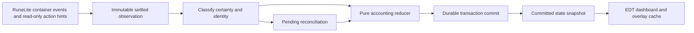

> Historical, superseded by Milestone 4 bank-only tracking. This is not the current product contract.

# Architecture and implementation plan

## Scope and inspection

M1–M3 passed user-run acceptance. M3 is committed as `5b7c49f`. The first M4 implementation passed 376 tests but failed live acceptance. The correction pass adds real-collector pipeline coverage, retained pre-bank acquisition evidence, independent legacy withdrawal deficits and the difference-focused Update Progress workflow. It awaits live retesting. GP/GE/valuation/buybacks remain unimplemented. No code was taken from purpleCounter. Accepted M3 geometry, clipping and tint are preserved; only signed values and the nonpositive lock predicate change.

Current correction evidence and the user-only procedure are in [MILESTONE_4_CORRECTIONS.md](docs/MILESTONE_4_CORRECTIONS.md). Historical M3/M4 descriptions below are qualified by this correction: storage now uses format 4; unchanged/transfer-only sessions reopen automatically; unresolved review lives in Account Tools.

The M2 checkout was clean on `master` at the user-created foundation commit. AGENTS.md and CLAUDE.md were reread. Java 11, the existing Gradle 8.10 Wrapper and dependency layout remain. `latest.release` resolves to RuneLite 1.13.3; actual identity/container/Filepath sources were checked. See [compatibility evidence](docs/COMPATIBILITY.md).

## Packages and responsibilities

| Package | Classes | Scope |
| --- | --- | --- |
| `com.fromscratch` | `FromScratchPlugin`, `FromScratchConfig` | Implemented lifecycle, DI, preferences |
| `model` | `RunState`, `RunStatus`, `RunRecord`, `InitializationSession`, `LegacySnapshot`, `ContainerSnapshot`, `SnapshotLocation`, `VirtualEconomy`, `VirtualOwnership`, `VirtualItemOwnership`, `VirtualLocation` | Immutable baseline, lifecycle/setup, exact-ID virtual totals and allocations; currency/wealth placeholders |
| `ui` | `FromScratchSidebar`, `FromScratchPanel`, `SetupView`, `SetupActions`, `PreparationChecklist`, `ItemReview`, `ItemReviewTable`, `ItemReviewDialog`, `RunDuration` | EDT presentation, guided steps, snapshot-bound corrections, history and elapsed duration |
| `controller` | `SetupController` | Implemented client/worker coordination and stale-callback rejection |
| `observation` | Existing snapshot readers plus `ItemObservationCollector`, `ItemObservation` | Identity, full API containers, verified empty personal views, session-bound caches, event/tick correlation and read-only action hints |
| `overlay` | `VirtualBankOverlay`, `BankItemPainter`, `BankOverlayState`, `BankOverlayRegistration`, `VirtualQuantityFormatter` | Normal-bank rendering, immutable projections, cached labels, independent settings and exactly-once registration |
| `tracking` | Prior item classes plus `LegacyBankDeficits`, `ItemReviewEdits`, `ItemTrackingDiagnostics` | Independent earned/deficit state, pure reducer, explicit bounded decisions, optional one-item trace and durable batches |
| `persistence` | `RunRepository`, `RunRecordCodec`, `SaveIntegrity`, `SaveException`, `ItemJournalCodec`, `ItemJournalStore` | Version-4 checkpoints, journal envelope 2 (reads 1), forced format-1/2/3 migration and conservative recovery |
| `valuation` | `PriceSnapshot`, `WealthCalculator`, `CostBasis` | Planned cached prices and historical basis |
| `buyback` | `BuybackCatalog`, `BuybackService` | Planned eligibility and atomic spend/unlock |

Subpackages are beneath `com.fromscratch`. Future names are guidance, not empty scaffolding. Introduce classes with meaningful milestone tests. Resolve gameval constants from the actual API instead of embedding item/widget IDs.

## Lifecycle and thread ownership

RuneLite injects config, observer, coordinator, repository and sidebar. Swing handles navigation and dialogs. All identity/container access and InitializationSession mutation occur on the client thread. A bounded single background worker performs all storage, including obtaining the plugin directory. Its results return via ClientThread.invokeLater and are rejected after a character/context/lifecycle change. The UI receives immutable SetupView objects, never live client state.

Shutdown invalidates callbacks, calls shutdownNow without waiting, removes navigation and unregisters the single bank overlay. No scheduled task, timer, custom network or gameplay action is created. An already completed but unacknowledged write is discovered by reload; an incomplete write preserves recovery evidence. Never report Active before successful durable storage. Repeated toggles and stale callback orderings have deterministic tests.

The root 48x48 Hub icon and bundled 24x24 resource are separate small assets. RuneLite `ImageUtil.loadImageResource` loads the class-relative resource. Classpath resources are distinct from user-data file storage.

Initial setup retains its guided preview and explicit confirmation. The active primary dashboard shows three financial placeholders, elapsed duration, lifetime unlocked types and recent acquisitions. Update Progress, protected Reset, retained deficits and collapsed Transaction History are secondary Account Tools. The editor defaults to changed rows, uses actual item names, search/numeric sort/filter/bulk choices and an apply summary. Advanced quantities remain physical-bounded; cancel never saves. All state is immutable/EDT-bound; no live client widget is used by the editor.

## M3 ownership and rendering

VirtualOwnership is an immutable hash map by exact item ID, independent of the legacy baseline and physical quantities. Missing records and locations are valid zeros. VirtualItemOwnership stores a separate nonnegative long total and sparse BANK/INVENTORY/EQUIPMENT/GRAND_EXCHANGE allocations. Checked allocation sum must not exceed total; the difference is unallocated ownership, never automatically bank-available. Zero records normalize away. M4 retains this model: validated plans use RunRecord.withItems while preserving the run header and original LegacySnapshot. The earlier withOwnership helper is restricted to unestablished fixture/import records; established progression requires a journal-backed update. No grant-items control exists.

SetupController sends committed Active views to BankOverlayState before Swing. Its immutable projection contains ownership, independent legacy deficits and preformatted signed bank labels; missing entries return "0". Settings refresh independently on ConfigChanged. Loading, unresolved review, errors, reset, logout and disable clear the projection; an ordinary save retains the previous committed projection until acknowledgment. Identity checks prevent cross-character display. The correction adds signed values and a nonpositive dim predicate without altering the accepted bounds, clipping, tint or input handling.

VirtualBankOverlay is a manual/dynamic/low-priority Overlay hooked only after InterfaceID.Bankmain.ITEMS. Its frame gate checks enabled/Active, verified character, mounted visible normal bank and PIN absence. The earlier WidgetItemOverlay path consumed RuneLite 1.13.3's item list, which tests whether the item origin is inside the clip. Consequently it omitted the still-visible bottom portion of a top-clipped row. Installed renderer bytecode inspection confirmed that coordinates are updated before that origin test. No unsupported members or obfuscated names are used in production.

The replacement reads the current ITEMS layer's actual child widgets, requiring the expected component, direct parent, GRAPHIC type, visible state and real item ID. It uses Widget.getBounds and Rectangle.intersects against the content viewport (ITEMS bounds intersected with ITEMS_CONTAINER bounds), then intersects the original graphics clip and full item bounds for painting. Partial top, bottom and side intersections are included; mere edge contact and offscreen items are excluded. Tabs/search controls, bank-side inventory, shared/special storage and equipment are outside this source/clip. No fixed slot/grid coordinates are computed. A zero-quantity or definition-identified placeholder always displays zero; bank fillers, BLANKOBJECT sentinels and negative IDs are skipped.

RuneLite's current OverlayManager widget list is consulted only for an actual drag rectangle; it is no longer the source of ordinary bank-item visibility. The same widget is painted once at its supplied drag position. If an active dragged widget is missing that rectangle because its origin is clipped, its transient effect is omitted rather than painted at the old slot or inferred from mouse coordinates. It returns on release. Context provides a synchronous client-thread visitor for testing; no per-item DTO or ownership map is constructed. Purple labels always use full item bounds, never the intersected fragment.

BankItemPainter uses the bundled RuneLite small font, black shadow and bottom-right alignment. The lock is a uniform dark neutral-gray tint (RGB 80/80/80, alpha 122/255, approximately 48%) over the complete current item bounds. This replaces the first refinement's RGB 128/alpha 77 tint, which the user requested be slightly darker. The darker neutral color is closer to the bank background, reducing tile contrast while muting colorful sprites. There is no reserved top band or partial-height rectangle. This fallback is not full sprite grayscale; it also tints the background and ordinary quantity glyphs, retaining approximately 52% contrast. Purple counters are drawn last without tinting. The original 57%-opaque black mask started 12 pixels down, causing the earlier bright-top/dark-bottom split. Graphics paint/font/clip are restored; game widgets, sprites, IDs, quantities, menus and click zones are never changed. Java2D/client transforms apply scaling; no second UI scaling factor is invented. Other overlays may compete for the same corner, requiring manual compatibility tests.

RuneLite 1.13.3 provides ItemManager.getImage, Client.createItemSprite and ImageUtil.grayscaleImage. These create/convert a separate image rather than desaturating the already-composited bank item. Redrawing it safely would require matching the actual sprite, its quantity glyphs, border, shadow, opacity and drag appearance. ItemManager uses its own fixed border/shadow/quantity-mode options, and Widget does not expose a sprite-shadow getter. Cached generated grayscale replacement was therefore not adopted for this correction. One full-bounds fill per locked visible item avoids additional sprite-generation, grayscale-conversion or image-cache work; see docs/COMPATIBILITY.md.

No disk/price/accounting work occurs in rendering. The source makes a linear pass over the current bank item widgets; only intersecting items are drawn or trigger cached placeholder lookups. Ownership/label lookup is O(1), labels/maps are built only when the committed projection changes, and placeholder definitions are cached by item ID for the enabled lifecycle. There is no new image cache, sprite generation, grayscale conversion or per-frame item map. Registration is idempotent; shutdown clears render data and the definition cache. Actual client scrolling cost and layout compatibility still require manual acceptance/profiling; a clean build is not that evidence.

## Run lifecycle and identity

Stable states: NOT_STARTED, INITIALIZING, ACTIVE, NEEDS_RECONCILIATION, COMPLETED. No pause. RunState validates schema, opaque character key, UUID, status, and start/end instants. Initialization has an ID but no activation time. Ongoing runs require activation time and no end time. Completed runs require an ordered end time. Invalid headers fail without producing an empty replacement.

M2 supports NOT_STARTED -> ephemeral INITIALIZING -> persisted ACTIVE, and confirmed reset -> persisted NOT_STARTED. Reset archives the active run and does not create a replacement. Initialization requires a complete snapshot and confirmation. Reload preserves UUID, times and baseline; cancellation/logout/disable discard only an unconfirmed preview. NEEDS_RECONCILIATION/COMPLETED are stable header names reserved for future engines; M2 refuses unsupported persisted states rather than erasing them.

M2 verifies LOGGED_IN/local player, live account hash, current RuneScapeProfileType and the selected ConfigManager RS profile against one matching RuneScapeProfile. The stable storage key is SHA-256 of a namespaced versioned account-hash/type tuple. Unlike a random configuration key, it remains stable across display-name and RuneLite config-profile changes; standard/temporary world profile types remain separated. Raw account hashes, display names, inventories and paths are never logged. Unknown/mismatched/ambiguous identity blocks setup and storage. Tests exercise renames, changed config keys, characters and profile types.

## M2 snapshot availability

Bank readiness is independent of ItemContainerChanged. RuneLite's BankPlugin uses WidgetLoaded/WidgetClosed for BANKMAIN lifecycle and quantity events for cache invalidation. The former fresh-event gate was incorrect: reopening an unchanged bank need not produce another quantity event, and an early failed capture previously stopped retrying.

RuneLiteSnapshotObserver checks the live mounted-interface component table, so cached widget definitions/closed-bank containers cannot establish readiness. BankSnapshotReader requires BANKMAIN mounted, Bankmain.ITEMS_CONTAINER visible, no BANKPIN_KEYPAD/BANKPIN_SETTINGS mounted, and a settling game tick for current bank capture. It always reads the complete BANK container while the normal bank is open, including confirmation. An already-open bank is discoverable without WidgetLoaded. Null/partial bank data is unavailable; a validated non-null empty bank is legitimate. Visible bank item children and search/tab counts are never bank snapshot sources.

The 1.13.3 Client getter is explicitly nullable for each container; core ItemStatPlugin/ItemStatOverlay null-check INV/WORN independently. Simultaneous availability is not an API promise. During INITIALIZING, poll all available personal containers even before the bank opens. Keep immutable validated observations for at most 60 seconds in this uninterrupted verified-character setup session. Null reads never create empty data or refresh observation age. A partial/invalid observation invalidates that location. Container events invalidate the changed location, optionally copy its valid event payload, and require a settling tick. A changed previously observed bank also invalidates both cached personal observations to avoid mixing transfer sides. Initial bank loading does not itself prove a personal change.

WidgetLoaded/Closed invalidate bank readiness; GameTick polls only pending setup, including ready previews, so observations expire even without events. Complete current bank data combines with valid personal observations into an immutable preview. Confirmation revalidates identity, current bank and available personal data, age and change guards. Changed contents expire the review token; missing/stale data disables confirmation and identifies the normal interface to open manually. Cancel, logout, identity change, disable and a new Begin discard ephemeral observations. Active baselines never recapture. CaptureProgress exposes each location independently; equal SetupView objects do not rebuild Swing each tick.

Observed zero-length/all-empty-slot containers are valid; no positive-count requirement exists. The user isolated the live failure to empty INV/WORN: the adapter lacked a way to verify that absent API objects represented empty locations. PersonalContainerReader still prefers complete API arrays. For null INV/WORN only, EmptyContainerVerifier requires every slot in a mounted, visible personal interface to show its initialized empty state on two different game ticks. Inventory uses all 28 hidden BLANKOBJECT children (normal or bank-side inventory). Equipment uses all 11 logical item slots, each with its hidden item child and visible initialized empty icon. Ring/ammo are included; player appearance is not evidence. Missing/default/partial widgets stay unknown. A visible item with a null container rejects cached observations instead of reconstructing populated contents from widgets.

Verification candidates reset on item-container events, personal interface load/close, identity/session changes and Begin/cancel. Completed empty observations follow the existing 60-second cache/invalidation policy. Complete BANK data and explicit confirmation remain mandatory; no bank widget fallback exists. Checked long aggregation, placeholder/filler exclusion and raw variants are unchanged. DEBUG diagnostics remain limited to one line per ten seconds and add emptyVerification status without item lists or identity. No independent packet-completeness/version signal exists; unsupported layouts remain blocked. Save schema and persistence are unchanged.

## M4 observation, accounting and review

ItemObservationCollector copies the full BANK/INV/WORN containers on the client thread. It distinguishes observed empty/populated from unknown and preserves unchanged reliable history with session UUID, timestamp and event version. Changes invalidate only affected locations; null reads never invent deletions. Personal empty verification reuses the accepted M2 reader. The explicitly confirmed initial snapshot seeds current-session observations so verified-empty personal containers survive the setup-to-tracking handoff. Restored snapshots never seed current observations.

Changes are compared only after a full quiet game tick (`tick > changedAt + 1`). Bank payloads may establish authority only while the normal bank is visibly open; a valid event just before closure retains that transfer leg. Closed-bank changes invalidate bank authority and require reopening/review. Bank rearrangement, stack splitting, tab/search filtering and slot order do not change aggregate Holdings. During review, personal observations expire after 60 seconds; during live play an unchanged observation survives temporary API absence until an invalidating event. Availability/age diagnostics are DEBUG, throttled to ten seconds, without item lists or identity.

ItemAccountingEngine has no client, Swing, storage or network dependencies. It matches same-ID transfer legs first, then only explicit noted/unnoted item-definition links. Virtual-first allocation conserves total ownership across bank/inventory/equipment. Remaining ordinary positive deltas credit acquisitions after known returns are excluded. Unknown decreases, unmatched banking increases, coin-funded outputs and known unsupported collection/transformation contexts require review. Different-ID uncertain outputs default to locked. Eat/Drop menu observations are hints requiring matching later quantity changes; no menu/input is modified. Charged variants, doses, crafting, GE and special storage lack an automatic economic policy.

ReturnBalance retains removed legacy and virtual copy counts. Returns match legacy first, then restore virtual copies without a second acquisition. A manually preserved Elsewhere copy is relocated, not added again; ambiguous returns require review. Elsewhere is bounded by previously virtual totals and never silently bank-available. See ACCOUNTING.md for exact equations and conservative limitations.

ItemTrackingSession obtains a safe current-session comparison automatically. Unchanged or fully matched transfer-only batches reopen tracking without player approval or speculative acquisition. Missing data stays pending with a secondary observation instruction. A meaningful unresolved gain/loss opens Update Progress in Account Tools. Tokens bind to session and all Holdings; closure/movement/stale data rejects apply. Canceling an optional review returns a trusted session to tracking without a save; unresolved discrepancies remain pending. Same-character ordinary loading/hops preserve authority where reliable; true logout/identity/lifecycle change resets it.

The collector retains ordinary aggregate increases observed outside banking until that exact observation is acknowledged. A later bank opening/deposit cannot discard that receipt evidence. Ground Take is a read-only bounded hint requiring a matching quantity change. Unmatched banking increases without such evidence remain reviewed. Acknowledgment carries the immutable observation, not only a tick/version, so delayed storage callbacks cannot replace the physical evidence baseline with newer quantities. Receipt checks visit only personal item IDs against cached totals; they do not rescan the whole bank a second time.

LegacyBankDeficits stores nonnegative outstanding legacy withdrawals by explicit supported identity, separate from VirtualOwnership. Virtual-first bank transfers update D only for their legacy remainder. Purple display is earned BANK minus D; zero/negative stays dimmed. Deficits remain in Account Tools if the bank slot vanishes. Corrections and signed deficit deltas share the ownership/ledger commit boundary; repaying D never creates an acquisition. See ACCOUNTING.md for examples.

ItemTrackingDiagnostics is opt-in, one selected item, DEBUG and throttled per stage. It traces copied before/after location quantities, gate/stability/source context, pending reason, classification, durable result and the actual signed value reaching the renderer. Default-off rendering adds no log formatting, price or IO work. No full snapshot/identity/path is logged. This supports user-assisted live diagnosis; synthetic debugger evidence does not prove the user's account path.

The Swing checklist marks reliable empty observations complete. Corrections are local, bounded by physical location quantities, reasoned and confirmed. The permanently-removed option avoids reserving confirmed destroyed copies; otherwise uncertain removals retain return identity. The proposal has no authority until storage succeeds. Acquisition history excludes rejected proposed gains and preservation of already-owned copies; lifetime unlocked types survive later losses. Unknown layouts/containers guide the user to the relevant normal tab without deleting trusted state.

## M4 local persistence and journal

Permanent storage decision: one designated host computer owns the local progression files. Cloud synchronization, cloud credentials, cloud storage and third-party backends are out of scope permanently. Mobile/other-computer activity is reconciled against observations when returning to that host (M4), not merged from remote saves. Manual backups and deliberate host migration remain supported procedures; no external service is added.

M2 wrote envelope 1, M3 envelope 2, initial M4 envelope 3, and the correction envelope 4; header schema 1 stays unchanged. Format 4 requires ownership, physical checkpoint, returns, bounded history, lifetime unlocks, session/cursor and legacyWithdrawals. Journal envelope 2 adds signed legacyWithdrawalChange per entry and still reads verified envelope 1. Explicit Gson trees/constructors validate fields and checked arithmetic. Missing required new data is corruption, not zero initialization. Financial fields remain reserved zeros.

Verified format-1/2/3 migration first forces/verifies exact-byte backups. Established format-3 journal heads are checked against their original canonical encoding before migration. Append a linked migration marker and new checkpoint, preserving original segments, acquisition history, run/header/character/start/baseline and ownership. Formats 1/2 and unestablished 3 retain their data without inventing tracking history. Newly introduced deficits start at zero; older omitted counters need an explicit declaration rather than unsafe reconstruction (especially note conversions). Failed or interrupted migration preserves old current/chain/backups and orphan evidence; restart retries safely. Older software cannot open format 4; rollback is a deliberate private restore, not merging histories.

The plugin Filepath directory contains characters/<opaque-key>/current.json, checkpoint-<revision>.json, archive-<run>-<unique>.json, migration backups, ledger-<run>-<revision>.json and a cooperative run.lock. No progression path is repository-relative. Reads/writes use a nonblocking per-character file lock to reject conflicting clients. Each checkpoint/segment has bounded size; the complete journal is not a config string or embedded full history. Load never writes a default run.

Commit: force and validate a new immutable checkpoint; force a pending current file; atomically replace current.json where supported; otherwise copy/force with the checkpoint retained; validate current before acknowledgment. Reset first copies, forces and validates a unique archive. Its Not Started record prevents reloading an old active checkpoint automatically. Missing/corrupt/incompatible current data is an explicit error; files are preserved and setup is blocked. Recovery is manual, documented in README; no automatic checkpoint promotion or import/export UI exists yet. Retained checkpoints/archives are not automatically pruned. File forcing plus recoverable copies does not guarantee survival of every filesystem/hardware failure.

RunRepository tests inject publication failures after checkpoints/archives to verify preservation and blocked blank restarts. A test-only Filepath.Unchecked root is confined to JUnit-created synthetic temporary directories; production uses only Plugin.getPluginDirectory and supported Filepath operations.

M4 implements the item journal below. Future financial milestones must extend it through explicit migrations for cash, reference valuations/basis, GE lifecycle references and bundle/buyback entries. They must preserve idempotence and whole-transaction commits. JSON decoding must continue to use validating constructors; header schema and outer storage format remain distinct compatibility boundaries. No financial transaction is inferred by M4.

All storage uses `Plugin.getPluginDirectory()` / `Filepath` under internal name `from_scratch`, with per-character/run namespaces. Small preferences remain in ConfigManager; the journal is not one config string. No raw file escape, Filepath.Unchecked, Java serialization, or plugin-created external process.

Each item save compares the whole expected run/revision, verifies prior journal authority and validates that transaction virtual/location deltas explain the candidate ownership. It writes/forces/verifies an immutable batch segment, forces the resulting checkpoint, then publishes current through the existing pending/atomic-replace or recoverable-copy path. Repeating the identical completed save is idempotent; stale writes fail. The current checkpoint and its referenced chain form the commit boundary. An orphan segment from an interrupted publication is retained but never automatically replayed. Only a successful worker acknowledgment updates the session, dashboard and overlay; failures require Retry Load rather than repeated automatic writes.

Each batch carries character/run/session, sequence, timestamp, UUID, previous head/revision and SHA-256 of the resulting checkpoint. Entries carry unique IDs, exact item IDs, quantity, signed virtual/location changes, source/destination, classification, confidence and reason. Load validates the referenced chain, all checksums, sequence/identity/event uniqueness, recent-history references and head/result agreement. Normal writes validate the head instead of rescanning the whole chain. Full load validation is linear in history on the worker. No orphan promotion or fabricated history occurs.

Recent/checkpoint histories are bounded at 50 entries, but all immutable journal segments and recovery checkpoints are retained. Disk growth and long-history loading need M9 profiling/retention design. Backups/recovery must preserve the whole character directory including the chain; a standalone current.json is insufficient. No user files were inspected or migrated during development tests.

Cancel any future scheduled tasks and call shutdownNow without waiting. Future import/export must validate schema/identity/quantities/sequences/integrity in staging and use Filepath.Chooser. Protected reset preserves archives and the prior run's journal; it never creates a replacement run. There is no import/export UI yet.

## Compliance and capability limits

- Enforcement uses visual overlays/warnings. No input injection, action blocking, packets, server-directed menu additions, or conditional removals are planned.
- Container events expose counts, not provenance. Identical copies cannot be identified individually. Special storage is excluded; death fees require reliable evidence or manual entry.
- Offline history, missing bank data, and ambiguous transformations cannot be reconstructed. Preserve trusted state and reconcile.
- GE events do not guarantee complete trading history. Commitments, partial fills, tax, uncollected positions, and collection require targeted evidence.
- The core Examine plugin uses normal menu observation and local queued chat. M8 must validate context/deduplication while preserving original messages and outgoing chat.
- Prices are estimates. Unpriced untradeables have zero market valuation and an explicit incomplete marker.
- No external server, telemetry, custom HTTP, reflection, native access, or new production dependency is needed.

References: [Jagex guidelines](https://secure.runescape.com/m=news/third-party-client-guidelines?oldschool=1), [rejected features](https://github.com/runelite/runelite/wiki/Rejected-or-Rolled-Back-Features), [Hub review](https://github.com/runelite/runelite/wiki/Plugin-Hub-Review).

## Decisions before dependent milestones

| Decision | Proposed direction | Resolve before |
| --- | --- | --- |
| Identical-copy allocation | M4 virtual-first transfers/reductions; legacy-first conservative returns; reviewed overrides | Implemented M4 |
| Notes/charges/doses/recolors | Explicit notes supported; other transformations require review, no blanket variation merge | M4 policy; expand only with tests |
| Physical legacy GP spending | Warn/reconcile; never recompute virtual cash from the remaining physical stack | M5 |
| Cost basis | Pooled weighted average with exact remainder handling per ACCOUNTING.md | M5 |
| Non-Graceful outfit bundles | Full sets; exact recolor/upgrade/partial rules still required | M7 |
| Graceful variants | Six standard locked pieces required; natural quantities remain independent | M7 |
| Time played vs elapsed duration | Separate elapsed run time and observable logged-in time; disclose mobile gaps | M8 |
| Unobserved locations | Explicit review; retain known ownership Elsewhere when confirmed; no null-as-deletion | Implemented M4 |

Financial/outfit/gameplay-time policies remain choices for later engines. M4 item decisions are explicit above and tested independently of rendering.

## Milestone plan and gates

| Milestone | Work | Automated gate | User acceptance |
| --- | --- | --- | --- |
| 1 Foundation | Identity, lifecycle, sidebar, header, artwork, docs, CI | Header/UI/resource/Java 11 tests and clean build | Launch, sidebar, toggles, help, login states |
| 2 Initial Snapshot | Complete containers, legacy capture, per-character saves, protected reset | Empty/populated/placeholders/gear/GP, duplicate init, identity, reload | Correct full snapshot, zero virtual balances |
| 3 Virtual Bank | Location quantities, purple counts, gray legacy items | Quantity/display models, restart | Scroll/tabs/search/scaling/withdrawn stacks |
| 4 Transfers/Acquisitions | Coalesced events, allocation, corrections, offline changes | Conservation, deduplication, ambiguity/mobile cases | Transfer and reconciliation scenarios |
| 5 Currency/Wealth | Ledger, cash/debt/commitments, basis, pricing, losses | Arithmetic bounds, debt, valuation, conversions | Costs and totals agree with ledger |
| 6 GE | Partial offers, positions, tax, cancellation, collection | Offer replay and collection deduplication | Partial fills/cancels/collection choices |
| 7 Buybacks | Curated catalog, bundles, atomic transactions | Catalog/exclusion/copy/crash tests | Eligible unlocks, physical cash unchanged |
| 8 UI Completion | Examine, history, bank view, settings, charts/time | Values/formatting/deduplication | Readability, context-specific examines |
| 9 Hardening | Recovery, migrations, profiling, compliance | Full regression and recovery | User-run regression/performance |
| 10 Publication | Release candidate, final metadata/art, manifest/PR materials | Reverify current rules and clean build | Explicit approval before submission |

Stop after each authorized milestone and report evidence. No automatic commit, push, publication, or later-milestone implementation.
